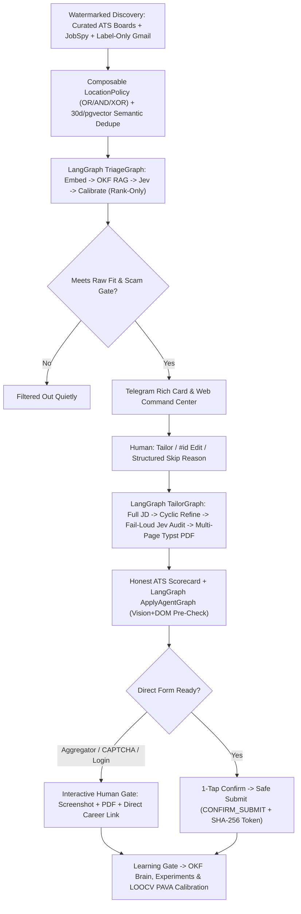

<p align="center">
  
</p>

<h1 align="center">RELENTLESS</h1>

<p align="center">
  <strong>An open-source, 24/7 personal job-hunting agent.</strong>
</p>

<p align="center">
  Finds fresh, high-fit roles across 237+ company career sites &amp; job boards, filters out ghost jobs, builds honest ATS-tailored resume PDFs, and keeps <strong>you</strong> in 100% control — for <strong>less than &#36;5/month</strong>.
</p>

<p align="center">
  <a href="https://github.com/Rohan-Thoma/Relentless/stargazers"></a>
  <a href="LICENSE"></a>
  <a href="https://github.com/Rohan-Thoma/Relentless/actions"></a>
  
  
</p>

<p align="center">
  <a href="#-5-minute-quick-start"><strong>Quick Start</strong></a> &bull;
  <a href="#-why-relentless"><strong>Why Relentless</strong></a> &bull;
  <a href="#-monthly-cost-breakdown"><strong>Cost Math</strong></a> &bull;
  <a href="#-see-it-in-action"><strong>Screenshots</strong></a> &bull;
  <a href="docs/SETUP_GUIDE.md"><strong>Setup Guide</strong></a> &bull;
  <a href="docs/USER_GUIDE.md"><strong>User Guide</strong></a>
</p>

---

<!-- SCREENSHOT PLACEHOLDER 1: Capture full-screen 01 // MISSION CONTROL (AMOLED dark UI with KPI cards + priority matches) and save as docs/images/hero-command-center.png -->
<p align="center">
  
</p>
<p align="center">
  <sub><em>The Relentless AMOLED Command Center: live job discovery funnel, match scores, resume studio, and knowledge brain synced 1:1 with Telegram.</em></sub>
</p>

---

## 🔥 Why Relentless?

Big tech is racing to build always-on personal agents like **Meta Muse** and **OpenAI Dots** that live in your chat apps and learn how you work. **Relentless brings that same 24/7 personal agent experience exclusively to your job hunt** — open-source, self-hosted, and built for real daily use instead of draining your wallet.

Most paid "AI job hunting" SaaS platforms charge **\$30–\$99/month**, burn through your credits fast, invent fake resume bullets to inflate scores, and pretend to "auto-apply to 1,000 jobs while you sleep" — right into CAPTCHAs, broken forms, and spam filters. Meanwhile, LinkedIn Premium costs **~\$30–\$40/month** and still leaves you grinding manually.

**Relentless flips the model — consumer-first, not monetization-first:**

| Feature | **Relentless (Open Source)** | Paid "AI Auto-Apply" SaaS | LinkedIn Premium | Manual Grinding |
| --- | --- | --- | --- | --- |
| **Monthly Cost** | **< \$5/mo** *(usually < \$1 in AI tokens!)* | \$30 – \$99/mo + credit walls | ~\$30 – \$40/mo | Free *(costs your evenings)* |
| **Runs 24/7 & Learns With You** | Yes — learns your taste + market trends | Static filters or black-box feeds | Basic job alerts | No |
| **Resume Tailoring** | **Zero-hallucination** PDF + ATS scorecard + instant `#id` edits | Generic rewrites or risky fabrication | None | Slow manual editing |
| **Blocked Pages (CAPTCHAs / Logins)** | **Honest escalation** — screenshots the blocker & hands you PDF + direct link | Fails silently or burns credits retrying | N/A | You hit the wall yourself |
| **Who Decides Every Step?** | **100% You** (Telegram + Web HUD) | Blind bulk spam | You | You |
| **Ownership & Privacy** | **MIT Open Source** — your DB, your keys, zero lock-in | Vendor lock-in + monthly billing | Platform lock-in | N/A |

---

## 🛡️ Honest Automation (Offloads the Grind, Never Fakes Autonomy)

Relentless does **not** make wild sci-fi promises it cannot keep. It knows where browser automation stops — and puts you in the driver's seat right where human judgment wins interviews:

1. **Relentless does the exhausting 90% 24/7:**
   - Polls curated, deduplicated **direct company ATS boards** (Greenhouse, Lever, Ashby, SmartRecruiters, Recruitee — with HTTP `ETag`/`304`, 3x-404 auto-pruning, and exponential backoff), public remote feeds (Remotive, Arbeitnow), optional bounded Workday CXS (opt-in), watermarked multi-board search via JobSpy (LinkedIn, Indeed, Naukri, Glassdoor with native `is_remote`), and label-only Gmail job alerts (including Naukri/Indeed/Wellfound/Instahyre & direct Greenhouse/Lever link ingestion).
   - Enforces a **composable `OR` / `AND` / `XOR` / `NOT` Location Policy** (default: strict Remote-only anywhere/worldwide — never conflating hybrid/APAC with remote or US Indiana `IN` with India, and checking JD text for foreign work-authorization or 5-day-onsite blockers).
   - Deduplicates reposted listings across a 30-day rolling window + **`pgvector` semantic similarity**, kills ghost jobs and scam traps via **`TriageGraph`**, and notifies you only on strong matches.
2. **You decide every application & surgical resume tweak:**
   - Tap **Interested** in Telegram or the Web Studio to run **`TailorGraph`** (LangGraph cyclic refinement): passes the **full untruncated JD** to your chosen OpenAI/OpenRouter model (default `gpt-4o`), preserves quantified metrics & multi-page depth (1–3 pages, zero 1-page cramming), transparently tags verified vs. adjacent ecosystem bridges vs. unverified stretch terms, verifies via a fail-loud Jev credibility audit, and computes a **100% honest, un-clamped ATS scorecard** strictly over rendered PDF text + semantic similarity.
   - Want to emphasize a specific project or add a tool? Reply directly in Telegram (`#42 highlight PyTorch inference latency and add Redis`) or use the Web Studio prompt box. Your instruction is executed immediately, and the OKF Brain distills the **meta-intent (WHY)** into generalizable tailoring principles.
   - Skipping a job? Choose a structured skip reason (**Experience Mismatch**, **Wrong Stack**, **Wrong Location**, **Expired / Closed**, **Scam**, or **Custom Note**). An **Intelligent Learning Gate** automatically excludes expired links and busy days so they never pollute OKF Brain or calibration.
3. **Radical honesty on blocked pages (Interactive Human Gate Handoff):**
   - **`ApplyAgentGraph`** fast-skips known login-walled portals (`linkedin.com`, `naukri.com`, `indeed.com`, `myworkdayjobs.com`) without wasting Chromium cycles, ignores site-wide navigation/search bars, enforces `max_free_text_questions`, dismisses cookie popups, pre-fills your details, attaches your tailored PDF, and captures step-by-step screenshots.
   - If a portal throws a **CAPTCHA / Cloudflare challenge**, requires a **password login**, or exceeds your essay cap, Relentless pauses cleanly at an **Interactive Human Gate** (never attempting CAPTCHA bypasses), shows you the live screenshot + exact blocker reason, and gives you the tailored PDF + direct link (plus a 3-stage Direct Career Resolver for aggregator links).
   - **Nothing ever submits without your explicit click.** Starts in `PREPARE_ONLY` mode by default (`MANUAL_ONLY`, `PREPARE_ONLY`, `CONFIRM_SUBMIT`), with daily caps, per-company cooldowns (`72h` default), and single-use SHA-256-locked confirmation tokens.

---

## 💸 Monthly Cost Breakdown

**Runs 24/7 for under \$5/month — here's the exact math.** Relentless pairs specialized decision models (`typesafe/jev-1.14`) and low-cost embeddings (`text-embedding-3-small`) with flexible model selection (**OpenAI** or **OpenRouter**) directly from the Web UI model picker.

| Pipeline Stage | Engine / Model | Typical Monthly Volume *(~100 jobs/day, 10 tailored/day)* | Est. Monthly Cost |
| --- | --- | --- | --- |
| **24/7 Job Discovery & Watermarked Polling** | Python + Direct ATS (`ETag`/304) + JobSpy + Label-Only Gmail | ~3,000+ listings scanned & deduplicated | **\$0.00** |
| **Semantic Embeddings (`pgvector`)** | `text-embedding-3-small` *(switchable via UI)* | ~3,000 JDs + OKF RAG queries | **~\$0.05/mo** |
| **Ghost-Job Filtering & Fit Scoring** | **TypeSafe Jev** (`typesafe/jev-1.14` on OpenRouter: ~\$0.042/1M input tokens, \$0 output) | ~3,000 jobs/mo (~1,500 input tokens each) | **~\$0.19/mo** |
| **Resume Tailoring + Credibility Audit** | `gpt-4o` *(default — switchable to `gpt-4.1`, `gpt-4.1-mini`, Claude, Gemini via UI)* + Jev Audit + Local Typst PDF | ~150–300 tailored PDFs/mo | **~\$1.20–\$2.50/mo** *(or ~\$0.25/mo on `gpt-4.1-mini`)* |
| **Vision + DOM Form Pre-Fill** | `gpt-4o` *(switchable via UI)* + Playwright | ~150 forms/mo | **~\$0.40/mo** |
| **Continuous Learning, Calibration & ATS Scorer** | **Google Cloud OKF** + Local Python / LOOCV PAVA + Experiments | Unlimited learning & A/B tracking | **\$0.00** |
| **Database, Notifications & Local Hosting** | Neon Postgres (`pgvector`, Free Tier) + Telegram Bot + Local/VPS | 24/7 persistence & alerts | **\$0.00** *(or ~\$5/mo optional Railway cloud)* |
| **Total AI API Bill** | **All models combined** | **Full daily job search** | **~\$2–\$3/mo** *(or < \$1/mo with mini models)* |

> Even if you tailor dozens of resumes a day **and** host in the cloud on Railway, your total bill stays cheaper than a single month of LinkedIn Premium — with **zero artificial credit limits**.

---

## 📸 See It in Action

### 1. Your Pocket Job Agent in Telegram
Get instant scored job cards on your phone, tap once to tailor your resume and pre-check the employer form, review the **Before → After ATS Match Scorecard**, tweak bullets by replying (`#42 emphasize FastAPI + Docker`), and approve or log applications from anywhere.

<!-- SCREENSHOT PLACEHOLDER 2: Side-by-side or stitched screenshot of Telegram: (Left) Scored Job Card with Fit/Scam % + buttons, (Right) Tailored Package with Form Preview Screenshot + PDF + ATS Scorecard + Auto-Submit / Request Changes buttons -->
<p align="center">
  
</p>

### 2. Web Application Studio (`03 // APPLICATION STUDIO`)
Inspect everything in one zero-distraction screen: Before/After ATS score boost, matched & missing JD keywords, full job description, live rendered Typst PDF, Playwright pre-filled form screenshots, and a surgical revision prompt box.

<!-- SCREENSHOT PLACEHOLDER 3: Capture 03 // APPLICATION STUDIO showing Scorecard & Diff on left, Tailored PDF / Playwright Screenshot on right, and Surgical Revision Prompt -->
<p align="center">
  
</p>

### 3. Honest Blocker Alerts (`CAPTCHA / Login Wall`)
When an application site requires a login or blocks bots with a CAPTCHA, Relentless never fakes a submission. It flags the exact blocker, attaches the screenshot, and gives you your ready-to-upload PDF + direct application URL.

<!-- SCREENSHOT PLACEHOLDER 4: Capture either Telegram blocker message or Studio Playwright escalation screenshot showing CAPTCHA / Login Wall detected + Direct Apply Link -->
<p align="center">
  
</p>

### 4. Self-Learning Career & Market Brain (`04 // OKF BRAIN`)
Built on **Google Cloud's Open Knowledge Format (OKF)**, Relentless turns every job you approve, skip, or flag — plus live market trends across incoming postings (in-demand skills, company hiring velocity, remote/city shifts) — into an interactive Obsidian-style knowledge graph that sharpens future matches automatically.

<!-- SCREENSHOT PLACEHOLDER 5: Capture 04 // OKF BRAIN in Obsidian Graph View showing lime (human-reviewed) & purple (machine-confirmed) nodes + Node Inspector -->
<p align="center">
  
</p>

### 5. Pipeline Kanban & Calibration Lab (`02 // PIPELINE` & `05 // ML CALIBRATION`)
Track every opportunity from `UNREVIEWED` → `READY_FOR_REVIEW` → `APPLIED` → `CALLBACK`, and verify that AI ranking measurably outperforms simple keyword matching using live `Precision@K` and calibration telemetry.

<!-- SCREENSHOT PLACEHOLDER 6: Capture 02 // JOBS PIPELINE (Kanban view) or 05 // ML CALIBRATION (Precision@K & Brier Skill charts) -->
<p align="center">
  
</p>

---

## ⚙️ Under the Hood: SOTA Tech Without the Bloat



| Component | Technology | Why It Matters to You |
| --- | --- | --- |
| **LangGraph AI Spine** | **`TriageGraph`**, **`TailorGraph`**, **`ApplyAgentGraph`** (`PostgresSaver`) | Every AI workflow runs as a stateful, checkpointed graph with cyclic self-refinement and Interactive Human Gate interrupts. |
| **Flexible Model Picker** | **OpenAI** (`gpt-4o`, `gpt-4.1`, `text-embedding-3-small`) & **OpenRouter** (`typesafe/jev-1.14`, Claude, Gemini, DeepSeek) | Switch chat, vision browser, embedding, and triage models live from `06 // CONFIG & VAULT` or `config/config.yaml` with zero code edits. |
| **Composable Location Policy** | **`LocationPolicy` Engine** (`OR` / `AND` / `XOR` / `NOT` + JD Blocker Scanner) | Strictly enforces Remote-only (default) or any city/hybrid/onsite rule combination with a live Dry-Tester in the Web UI. |
| **Continual Memory** | **Google Cloud Open Knowledge Format (OKF)** + **`pgvector` Semantic RAG** | Retrieves top-K relevant career insights semantically per job, learns meta-intent behind resume edits, and filters out expired-link skips via an Intelligent Learning Gate. |
| **Depth-Preserving ATS Engine** | `gpt-4o` (default) + **Multi-Page Typst** + **Honest ATS Scorecard** | Passes full untruncated JDs, preserves verified metrics & core skills, tags 3-tier skill provenance, and scores strictly over rendered PDF text (zero artificial score clamping). |
| **Honest Browser Agent** | **Playwright** + Vision/DOM Navigation + **Human Gate Handoff** | Fast-skips login-walled portals, ignores header/nav search bars, enforces `max_free_text_questions`, and hands off CAPTCHAs/logins transparently with screenshots. |
| **Calibration & Experiments** | **LOOCV-Validated PAVA Calibration** (`calibration_models`) + **`experiments`** | Persists calibration strictly for ranking priority (zero filtering death spirals) and tracks before/after Precision@K & Brier lift on every config change. |

---

## ⚡ 5-Minute Quick Start

You only need **4 things** to launch (zero paid SaaS subscriptions required):
1. Free **PostgreSQL database** from [Neon](https://neon.tech) (`DATABASE_URL`)
2. **OpenRouter API key** from [openrouter.ai/keys](https://openrouter.ai/keys) (`OPENROUTER_API_KEY` — \$1–\$5 credit lasts months)
3. **OpenAI API key** from [platform.openai.com/api-keys](https://platform.openai.com/api-keys) (`OPENAI_API_KEY` — for PDF tailoring & form fill)
4. *(Recommended)* Free **Telegram Bot** from `@BotFather` + a strong `WEB_API_KEY` login password

### Option A — 1-Service Cloud Deploy (Railway Direct)
1. **Fork** [Rohan-Thoma/Relentless](https://github.com/Rohan-Thoma/Relentless) on GitHub.
2. On [Railway](https://railway.app), click **New Project -> Deploy from GitHub repo** and choose your fork (uses the included `railway.json` & `Dockerfile`).
3. Add `DATABASE_URL`, `OPENROUTER_API_KEY`, `OPENAI_API_KEY`, `WEB_API_KEY`, and optionally `TELEGRAM_BOT_TOKEN` + `TELEGRAM_CHAT_ID` under **Variables**.
4. Generate a public domain under **Settings -> Networking**, visit your URL, unlock with `WEB_API_KEY`, and complete your profile visually in **`06 // CONFIG & VAULT`** — **zero CLI needed!**

### Option B — Run Locally (Linux, macOS, Windows — \$0 Hosting)

```bash
git clone https://github.com/Rohan-Thoma/Relentless.git
cd Relentless

python -m venv .venv
# Linux / macOS:
source .venv/bin/activate
# Windows PowerShell:
# .\.venv\Scripts\Activate.ps1

pip install -r requirements.txt
playwright install chromium

# Interactive wizard: creates .env, sets up Neon DB, auto-detects Telegram ID & builds starter profile
python manage.py setup

# Verify connectivity & readiness
python manage.py doctor

# Launch Web Command Center + Telegram Bot + 24/7 Pipeline
python manage.py run
```

Open **http://127.0.0.1:8000** in your browser!

---

## 📚 Full Documentation & Guides

Everything from our complete step-by-step setup and operations reference lives in dedicated guides so nothing gets buried:

| Guide | What's Inside |
| --- | --- |
| **[Setup & Deployment Guide](docs/SETUP_GUIDE.md)** | Step-by-step walkthrough for every API key, Neon pooler, `WEB_API_KEY` security gate, Telegram Chat ID auto-detection, Gmail IMAP alerts, Railway Direct, Private Netlify Edge Proxy setup, and local installs. |
| **[User & Operations Guide](docs/USER_GUIDE.md)** | Candidate profile setup, global region/city/job-board customization (US, UK, EU, India, Remote), full Web HUD `01`–`08` tour, all Telegram slash commands & `#id` resume edits, safety presets, live logs, MCP server, and `manage.py` CLI reference. |

---

## 🗺️ Roadmap & Contributing

Relentless is built to be practical, modular, and easy to extend:
- Add your favorite companies or regional boards right inside **`06 // CONFIG & VAULT`** or `config/config.yaml`.
- Pull requests are welcome for new ATS connectors, regional job boards, Typst resume templates, and evaluation benchmarks! Run `ruff check .` and `pytest tests/ -q` before opening a PR.

---

## ⭐ Support the Project

If Relentless saves you hours of job-board scrolling or saves you \$40/month on bloated AI subscription tools:
- **Star this repository** on GitHub so more job seekers can find a transparent, low-cost alternative!
- Open an [Issue](https://github.com/Rohan-Thoma/Relentless/issues) with ideas, bug reports, or new ATS connectors.

<p align="center">
  <sub>Licensed under the <a href="LICENSE">MIT License</a> &bull; Built consumer-first by <a href="https://github.com/Rohan-Thoma">Rohan-Thoma</a>.</sub>
</p>
